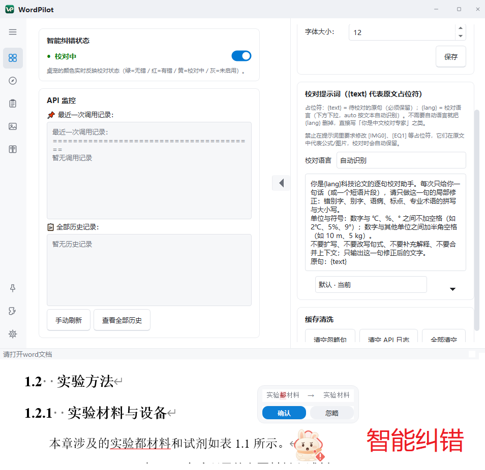
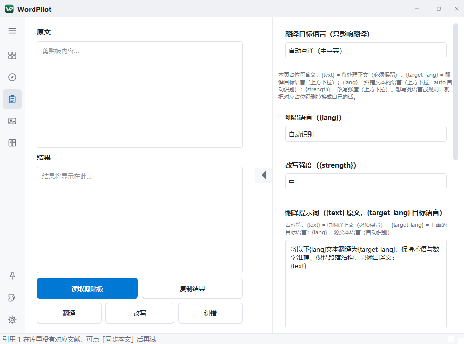
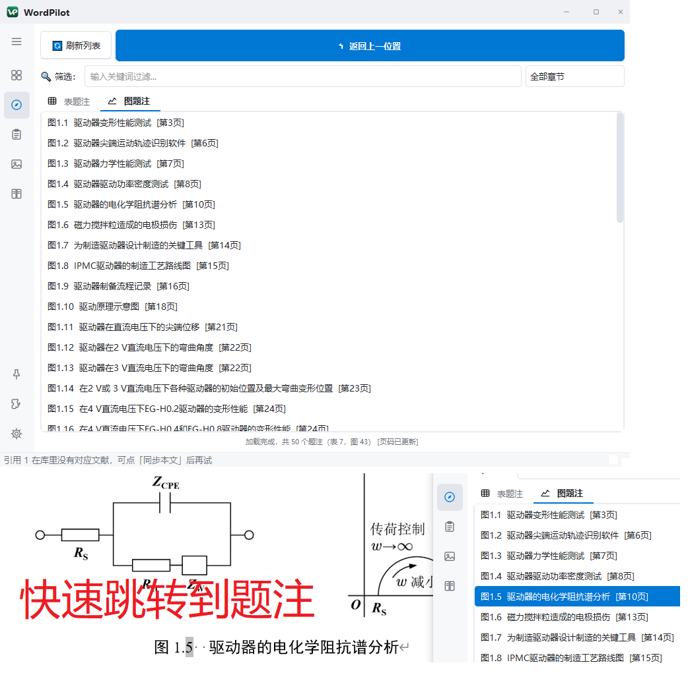
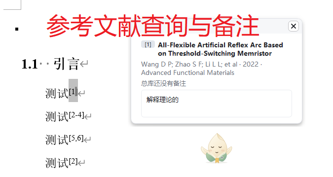
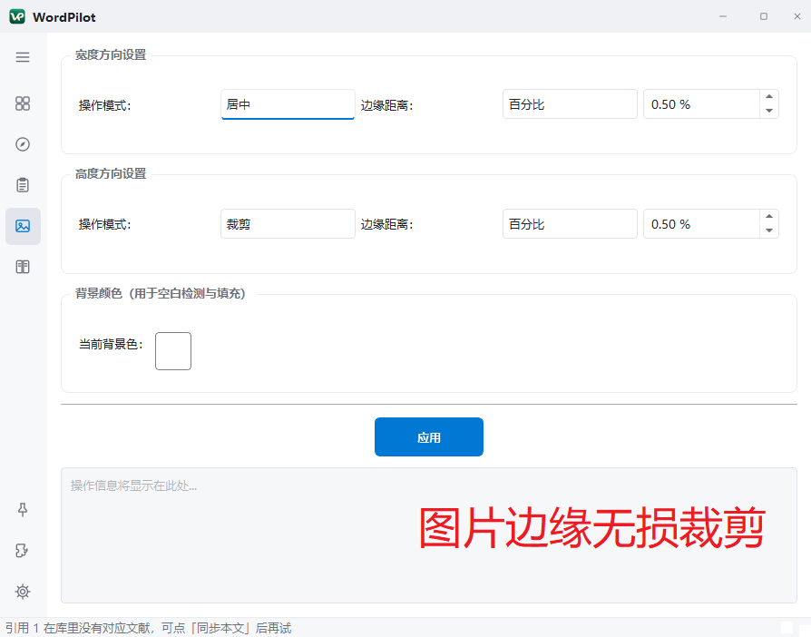
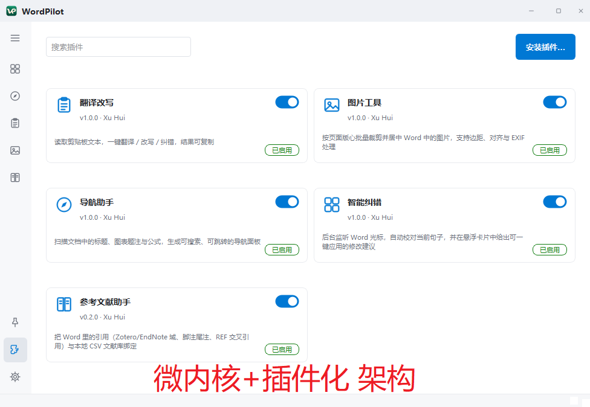

# WordPilot

[](https://github.com/OWNER/WordPilot/actions/workflows/ci.yml)
[](https://www.python.org/)
[](https://doc.qt.io/qtforpython/)
[](#系统要求)
[](LICENSE)

**面向高校论文写作的 Microsoft Word 智能助手**：实时 AI 纠错、翻译/改写、题录导航、
图片无损裁剪、参考文献助手 —— 全部集成在一个桌宠形态的轻量外壳里，
数据留在本机，只把「你要 AI 处理的那段文字」发给你自己配置的 API 端点。

> 当前版本 **v3.2.0**　作者 Xu Hui　许可证 MIT



## 界面一览

| | |
| --- | --- |
| <br>**智能纠错**：光标所在句子自动送校对，悬浮卡一键应用 | <br>**翻译改写**：翻译 / 改写 / 整段纠错，提示词可按插件独立管理 |
| <br>**题注导航**：扫描 Word 域生成图/表清单，双击跳转 | <br>**参考文献助手**：引用与本地 CSV 文献库绑定 |
| <br>**图片工具箱**：借隐藏 Word 文档无损裁剪居中 | <br>**插件管理**：安装 / 启停 / 排序，托盘只列已启用插件 |
| <br>**桌宠皮肤**（栗子柯基） | <br>**桌宠皮肤**（奶团兔） |


## 目录

- [核心特性](#核心特性)
- [系统要求](#系统要求)
- [安装与使用](#安装与使用)
- [配置 API Key](#配置-api-key)
- [多语言](#多语言)
- [隐私与数据边界](#隐私与数据边界)
- [从源码构建](#从源码构建)
- [插件化架构](#插件化架构)
- [开发与贡献](#开发与贡献)
- [版本与发布](#版本与发布)
- [已知限制](#已知限制)
- [许可](#许可)

## 核心特性

| 功能 | 说明 | 入口 |
| --- | --- | --- |
| **实时 AI 纠错** | 监控光标所在句子，句末完成后自动送 AI 校对，悬浮卡给出可一键应用的修改 | 后台监控 / `Ctrl+Shift+Z` |
| **校对桌宠** | 桌宠颜色实时指示状态（绿=无错 / 红=有错 / 黄=校对中 / 灰=未启用），8 套皮肤 | 桌面桌宠 / 右键菜单 |
| **翻译** | 选中文本或剪贴板内容翻译（自动互译 / 中文 / 英文 / 日文） | `Ctrl+Shift+T` |
| **改写** | 三种强度改写，目标降低 AI 痕迹、保持技术内容不变 | `Ctrl+Shift+R` |
| **整段纠错** | 对整段/整篇做最小改动纠错（术语与数字体例统一、跨句衔接），与逐句校对独立 | 翻译改写页 |
| **题录导航** | 扫描 Word 域(SEQ) 生成图/表题注列表，双击跳转、可返回上一位置 | 左侧图标轨 / 托盘 / 桌宠菜单 |
| **图片无损裁剪** | 借隐藏 Word 工作文档裁剪居中图片，保留原始像素 | 左侧图标轨「图片工具」 |
| **参考文献助手** | Word 引用（Zotero/EndNote/RIS/REF）与本地 CSV 文献库绑定，显示并编辑题注 | 左侧图标轨「参考文献助手」 |
| **提示词管理** | 每个提示词独立版本（默认 / 我的版本 / 自动备份），可切换、恢复默认 | 各插件页抽屉 |
| **插件管理** | 安装(zip/文件夹) / 启停 / 排序；托盘右键只列已启用插件的快速入口 | 左侧图标轨「插件管理」 |
| **API 监控** | 任务级 token 清单（输入 / 命中缓存 / 输出）、单次明细、日/月统计 | 设置 → API 监控 |
| **中英双语** | 界面语言一处切换，全部界面文案（含默认提示词、皮肤名、表头）跟随 | 设置 → 外观 |
| **主题** | 浅色 / 深色 Fluent 风 + 自定义 `config/user.qss` | 设置 → 外观 |

## 系统要求

- Windows 10 / 11（x64）
- **本机已安装 Microsoft Word**（2016 及以上；软件通过 COM 操作 Word）
- 从源码运行需要 Python 3.14；直接使用发布包则无需 Python

## 安装与使用

### 方式一：下载发布包（推荐）

1. 到 [Releases](https://github.com/OWNER/WordPilot/releases) 下载最新 `WordPilot-vX.Y.Z-win64.zip`；
2. 解压到**任意可写目录**（不要放在 `C:\Program Files` 下，软件需要在该目录写 `config/`）；
3. 双击 `WordPilot.exe`，首次运行会在同级目录生成 `config/`；
4. 打开设置 → API，填入你的 API Key。

### 方式二：从源码运行

```powershell
git clone https://github.com/OWNER/WordPilot.git
cd WordPilot
python -m venv .venv
.venv\Scripts\activate
pip install -r requirements.txt
copy src\config\MWindow_config.example.json src\config\MWindow_config.json
.venv\Scripts\python.exe src\main.py
```

也可以直接双击 `run.bat`。

## 配置 API Key

设置 → **API**：

| 字段 | 说明 | 默认 |
| --- | --- | --- |
| 接口地址 | OpenAI 兼容端点，可填根地址、`…/v1` 或完整 `…/chat/completions` | `https://api.deepseek.com` |
| 模型 | 任意兼容模型名 | `deepseek-flash` |
| API Key | 以 Fernet 加密保存在 `config/`，不入库、不外传 | — |

点「测试连接」可当场验证地址、模型与 Key 是否可用。

## 多语言

- 界面语言：设置 → 外观 → 界面语言（简体中文 / English），立即生效；
- **所有界面文案只有一个标准：界面语言**——包括内置默认提示词、提示词版本名、
  皮肤名、表头、存储清单、任务名。切换语言后回到中文，文字必须逐字复原（有测试守住）；
- 校对语言 / 翻译目标 / 纠错语言是**内容参数**，只决定「待处理文本是什么语言」，
  与界面显示无关；中文用户完全可以处理英文论文；
- 你自己保存过的提示词、自建文献库名属于用户资产，**不会被翻译**。

## 隐私与数据边界

**唯一外发的东西是「你要 AI 处理的那段文字」**，发往你在设置里填的端点。没有遥测。

以下文件只在本机 `config/`，已被 `.gitignore` 排除，发布包里也不含：

| 文件 | 内容 |
| --- | --- |
| `config/.key` | 加密主密钥（泄露 = API Key 可被解密） |
| `config/MWindow_config.json` | API Key、模型、偏好设置 |
| `config/api_calls.log` | 每次调用的输入/输出片段与 token 统计 |
| `config/proof_cache.db*`、`word_caption_cache.db*` | 校对/题注缓存（含原句、文档路径） |
| `config/plugins/**` | 用户资产：提示词版本、插件设置（永不参与清理） |
| `config/references/**` | 文献库 CSV 与索引 |
| `config/Image.docx`、`user.qss`、`*.log` | 工作文档、自定义样式、运行日志 |

完整清单与外发边界见 [`docs/PRIVACY.md`](docs/PRIVACY.md)；安全模型见 [`SECURITY.md`](SECURITY.md)。

## 从源码构建

```powershell
pip install -r requirements-dev.txt
.venv\Scripts\python.exe -m PyInstaller --noconfirm --clean WordPilot.spec
# 产物：dist\WordPilot\WordPilot.exe（onedir，约 103 MB）
```

打包显式收集：插件包、插件语言包、应用语言包、主题、SVG 图标、桌宠皮肤、
`assets/templates/Image.docx`（图片工具工作文档模板）、`*.example.json` 配置模板。
详见 [`docs/BUILD.md`](docs/BUILD.md)。

## 插件化架构

```
src/
├── __version__.py   # 版本号唯一来源
├── main.py          # 入口：建内核 → 建外壳 → 挂 UI → 加载插件
├── app/             # 前端表现层（PySide6，不碰 COM / API / 缓存）
├── core/            # 微内核：kernel / plugin_manager / sdk / services
└── plugins/         # 每个功能一个插件包（plugin.json + plugin.py + i18n/）
```

新增功能 = 在 `plugins/` 下新建插件包，**不改外壳与内核**。
插件协议与界面文案规约见 [`docs/PLUGIN_GUIDE.md`](docs/PLUGIN_GUIDE.md)，
架构与数据流见 [`docs/ARCHITECTURE.md`](docs/ARCHITECTURE.md)。

## 开发与贡献

```powershell
.venv\Scripts\python.exe -m pytest -q -p no:cacheprovider   # 离线单测（无需 Word）
pwsh -NoProfile -File tools\quality-gate.ps1                 # 隐私/体积/行数闸门
.venv\Scripts\python.exe tools\version.py --check            # 版本号与 CHANGELOG 一致
```

提交规范、界面文案做法、隐私红线见 [`CONTRIBUTING.md`](CONTRIBUTING.md)。
路线图见 [`docs/ROADMAP.md`](docs/ROADMAP.md)。

## 版本与发布

- 版本号唯一来源：`src/__version__.py`（语义化版本）；
- 变更记录：[`CHANGELOG.md`](CHANGELOG.md)（Keep a Changelog 格式）；
- 发版：改版本号 → 更新 CHANGELOG → `python tools/version.py --check` → 打包 →
  打 tag `vX.Y.Z` → GitHub Release 附 zip 与哈希；
- 完整流程见 [`docs/RELEASE.md`](docs/RELEASE.md)。

## 已知限制

- 仅 Windows；依赖本机 Word，不支持 WPS / LibreOffice；
- 单实例运行；多显示器与高 DPI 已适配但未做 4K 触屏专项测试；
- 未签名可执行文件，首次运行可能触发 SmartScreen 提示（可自行校验哈希）；
- 第三方插件在同进程运行，安装即等于信任其代码。

## 许可

[MIT](LICENSE) © 2026 Xu Hui
